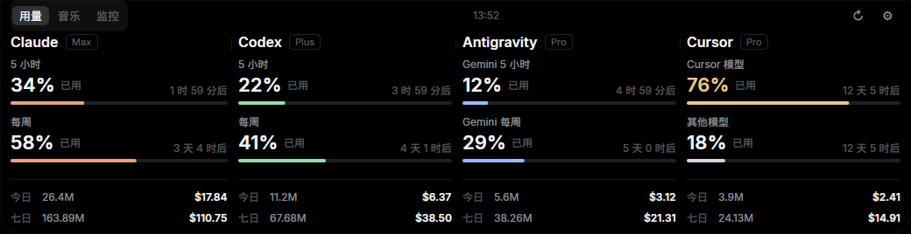
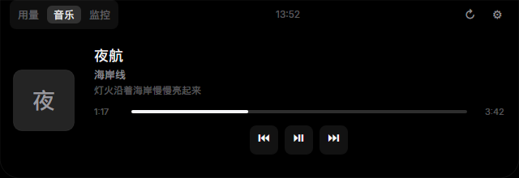
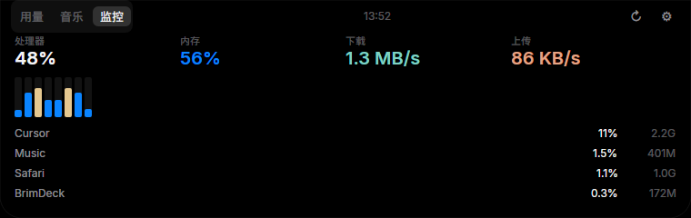

<div align="center">

<a href="README.md"></a>
<a href="README.zh-CN.md"></a>


# BrimDeck for macOS

The macOS edition of BrimDeck. It rests at the top of the screen and opens when you move the pointer over it, bringing AI coding quotas and the music you are playing into one place, along with how busy this Mac is.<br>
The layout and the data model follow the [Windows original](https://github.com/MoFeng2223/BrimDeck). Quotas, themes and settings still live in the shared `BrimDeck.Core` library.

[](LICENSE)


<p><a href="#features">Features</a> · <a href="#install">Install</a> · <a href="#what-this-edition-covers">What this edition covers</a> · <a href="#build">Build</a></p>



</div>

## Features

BrimDeck sits at the top center of the screen. The default shape is a notch; a capsule and a thin indicator are in settings. Move the pointer over it to open, and away to close. Esc closes it while the panel is focused. The menu-bar icon opens it again, opens settings, or quits.


- **Usage.** One column per tool shows the plan, quota and reset countdown. The footer totals tokens and estimated cost for today and the last 7 days. Claude Code, Codex, Cursor, Antigravity, ZCode, Kimi Code, DeepSeek Harness and the other sources from the original app are read the same way. On a Mac, Cursor's sign-in is read from `~/Library/Application Support/Cursor`.
- **Music.** The Music app and Spotify supply the title, a lyric line, progress and playback controls. On Linux, `playerctl` is used when it is installed, so the page can be checked during development.
- **System monitor.** CPU, memory, network speed and the busiest apps. Colors follow the panel theme.
- **Themes.** Dark, Light, and the original set: One Dark Pro, GitHub, Dracula, Night Owl, Cyberpunk: Edgerunners and the others.
- **Settings.** Language, launch at login, collapsed style and which tools are shown. API keys you type are stored in the login keychain, not as plain text.





## Install

Requires macOS 12 or later. Download the DMG for your Mac from [Releases](https://github.com/mutsuki14/BrimDeckMac/releases/latest), open it, and drag BrimDeck into Applications. If macOS blocks the first launch, allow it under System Settings → Privacy & Security.

You can also build the disk image on a Mac. The script uses `hdiutil`:

```bash
scripts/publish-mac.sh osx-arm64   # Apple silicon
scripts/publish-mac.sh osx-x64     # Intel
```

Launch at login installs `~/Library/LaunchAgents/app.brimdeck.mac.plist`. Quit from the menu-bar icon.

## What this edition covers

The Windows window, native integrations and installer stay in the repository so the port can be compared and kept in step. The macOS app draws its interface with Avalonia.

- Players today are the Music app and Spotify.
- Keys you enter are stored in the login keychain.
- The monitor shows CPU, memory, network speed and the busiest apps. macOS does not report GPU usage without extra permission, so that reading is left blank.
- When the front app is full screen, the panel follows the rule in settings and hides or becomes the indicator.
- Global hotkeys are not wired up yet.

The Claude desktop app keeps its token in the keychain. This edition does not decrypt that token yet. A Claude Code sign-in in `~/.claude` is read. When a source cannot be read, the panel shows that status and does not invent a number.

## Build

```bash
dotnet run --project src/BrimDeck.Mac
```

`--preview` opens the panel with sample data and does not contact an account. `--language zh-CN` picks the interface language.

```bash
dotnet run --project tests/BrimDeck.MacTests
dotnet run --project tests/BrimDeck.Tests
```

## License

[Apache License 2.0](LICENSE). Avalonia and SQLite are listed in [ThirdPartyNotices.txt](src/BrimDeck.Mac/ThirdPartyNotices.txt).

The system-monitor model, as in the Windows app, is adapted from [ftop](https://github.com/Nongfsq/ftop) by Nongfsq (MIT).
